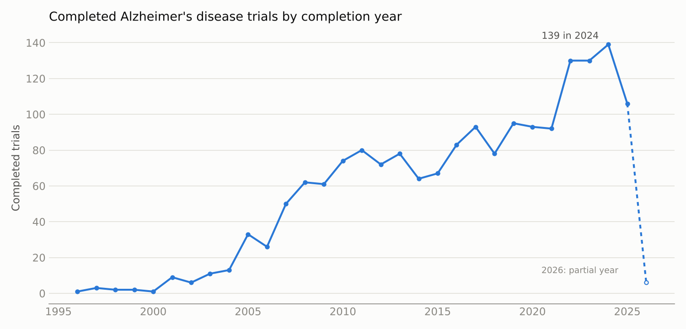

# Clinical Trials Analysis with Spark SQL

An analysis of more than 570,000 clinical trials registered on ClinicalTrials.gov, using Apache Spark SQL on Databricks. The full workflow is in [clinical_trials_analysis.ipynb](clinical_trials_analysis.ipynb), with all outputs saved.

---

## The business problem

A pharmaceutical company wants to understand the clinical research market: what kinds of trials are run, which conditions attract the most research, how long trials take, and where research activity is growing. At over half a million records, the data is too large to handle comfortably in a spreadsheet, so it was processed with Spark, which spreads the work across a cluster.

## The data

572,935 trials, one row each, with study title, status, conditions, interventions, sponsor, funder type, study type, design, enrolment, and start and completion dates. A check confirmed that every trial ID is unique, so each row counts as exactly one trial.

## Approach

1. **Inspect the raw file.** The first few kilobytes were read as text to see the true column names, quoting and separators before loading. This showed that the conditions field holds several conditions separated by a pipe character.
2. **Load with the right options.** The CSV was read into a Spark DataFrame with a header row, inferred data types, and multi-line and quoted field handling, so titles containing commas or line breaks were parsed correctly.
3. **Clean the column names.** Spaces were replaced with underscores so every column can be used directly in SQL.
4. **Query with Spark SQL.** The data was registered as a temporary view, and each question was answered in SQL, with intermediate views for multi-step logic.

## Findings

### Trial types

| Study type | Trials |
|---|---|
| Interventional | 437,333 |
| Observational | 133,604 |
| Expanded access | 1,033 |
| Unknown | 965 |

About three quarters of all trials are interventional, where participants receive a treatment being tested.

### Most studied conditions

One trial can list several conditions, so the conditions field was split on the pipe character and exploded into one row per condition before counting.

| Condition | Trials |
|---|---|
| Healthy (volunteer studies) | 10,873 |
| Breast cancer | 8,511 |
| Obesity | 7,324 |
| Stroke | 5,034 |
| Hypertension | 4,510 |
| Depression | 4,438 |
| Pain | 4,394 |
| Prostate cancer | 4,306 |
| HIV infections | 3,848 |
| Cancer | 3,836 |

Studies on healthy volunteers top the list, reflecting early-phase safety testing. Cancer, metabolic and cardiovascular conditions dominate the rest.

### Trial length

Across 552,589 trials with valid start and completion dates, the **average trial lasts 35.3 months**, just under three years. Month lengths were measured exactly with Spark's months_between function rather than approximated from days, and records where the completion date came before the start date were excluded as data errors.

### Alzheimer's disease research over time

Completed Alzheimer's trials grew from one or two a year in the late 1990s to a peak of **139 in 2024**, with a clear step up from about 90 a year to 130 a year from 2022. The 2026 figure covers only part of the year.

## Tools

Apache Spark (PySpark and Spark SQL), Databricks, Python.

## Data source

ClinicalTrials.gov, the registry of clinical studies run by the U.S. National Library of Medicine. The data is not included in this repository.
